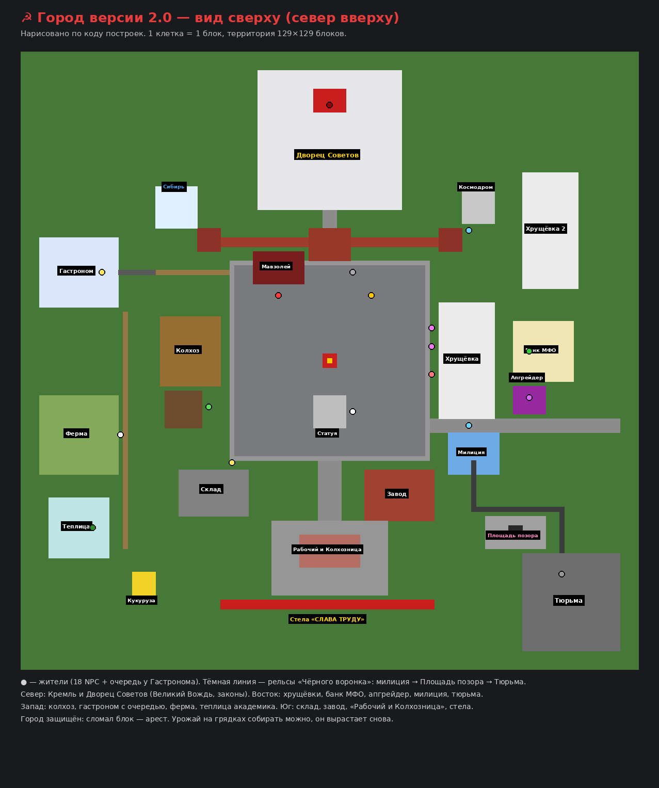

# ☭ Мод про Коммунизм 2.0 (Fabric 1.21.11)

Абсурдный кооперативный мод на 1–5 игроков. Великий Вождь и его законы, Пятилетка, указы партии каждые 10 минут,
милиция с вагонеткой «Чёрный воронок», тюрьма, площадь позора, микрозаймы, апгрейдер, игрок-Генсек
и финальная битва с **Мистером Капиталом**.

Мод работает на стороне сервера: друзьям, которые заходят по LAN или на сервер, ставить его не нужно.
Все окна — это родные диалоговые окна Minecraft 1.21.11, их присылает сервер.

## Установка
1. Fabric Loader для 1.21.11 + Fabric API.
2. `communism-mod-2.0.0.jar` → папка `mods`.
3. Зайдите в мир: через несколько секунд вокруг вас вырастет город.

## Главные цели
1. **Пятилетка** (5 этапов: Коллективизация → Индустриализация → Электрификация → Космическая программа → Светлое будущее).
   Ресурсы сдаются **Председателю Госплана** у Мавзолея (окно с кнопками «Сдать из руки» / «Сдать всё подходящее»).
2. **Финал:** Мистер Капитал — гигантский золотой босс. Победа = «Коммунизм построен».
3. **Смена власти:** после **10 законов** Великий Вождь устаёт, рассказывает об этом во Дворце Советов,
   улетает на ракете на дачу на Луне и **случайно выбирает Генсеком одного из игроков**.
   Генсек получает «Печать Генсека» (ПКМ): издаёт и отменяет законы, объявляет указы, амнистию, праздники, награждает товарищей.

## Законы (новое!)
Законы издаёт **Великий Вождь** во **Дворце Советов** (за Кремлём). Новый закон — каждые 6 минут,
одновременно действуют **3 последних**. Их видно в отдельной полосе вверху экрана и в окне «Свод законов».
Игроки могут сами предложить закон (10 трудодней).

20 законов, каждый проверяется по-настоящему:
о коллективизме · о буржуйском металле (золото изымается) · о трудовой дисциплине (кровати не работают) · сухой закон ·
о мирном небе (без PvP) · о всеобщей зарядке (10 прыжков за 30 секунд) · о плановой экономике · о бережливости (смерть — нарушение) ·
о вежливости (в чате — слово «товарищ») · о прямохождении (не приседать) · «Взгляд на Восток» (не смотреть на запад!) ·
о спокойствии (не бегать) · о головных уборах · налог на воздух (за прыжки) · о вегетарианстве (колбаса — не мясо) ·
об отмене гравитации · об отмене ночи · о спекуляции (не торговать с жителями деревень) · о минуте почтения (поклониться) · о тишине (короткие сообщения).

**Нарушение:** сначала предупреждение, повтор за 2 минуты — выговор. **3 выговора — арест.**

## Город и правосудие
**В городе ничего нельзя ломать** (кроме урожая — он вырастает снова). Сломал → сразу арест.
Приходит милиционер, нарушителя сажают в вагонетку и везут по рельсам, а после наказания — обратно на станцию. Наказания:
- **Тюрьма «Светлый путь»** — 60 секунд в камере; если долбить камень в камере, срок сокращается;
- **Площадь позора** — стоишь у столба, граждане кидаются снежками и «помидорами»;
- **Исправительные работы** на колхозе — собрать 12 растений;
- **Штраф**, **конфискация** (вещь уходит на Склад Народа), **лекция о вреде капитализма**, **ссылка в Сибирь**.

## Жители (18 + очередь)
Великий Вождь · Председатель Госплана · Политрук · Майор КГБ (выговоры, взятки, доносы) · Завхоз (магазин) · Агроном ·
Космонавт (полёт за 500–900 блоков) · Пионер Вася · Бабки Зина и Валя на лавочке · Поэт-агитатор · Банкир (микрозаймы) ·
Апгрейдер · Участковый · Надзиратель (УДО) · Продавщица Галя (товар дня) · Доярка · Академик · очередь у Гастронома.

## Микрозаймы — МФО «Серп и Процент»
4 займа (от «До получки» до «Ударного ипотечного»). Просрочка: коллекторы списывают трудодни, долг растёт,
а должника забирает милиция.

## Апгрейдер «Госудача»
Берёте предмет в руку, выбираете ×2 / ×3 / ×5 / ×10 — с шансом 45/29/17/8% получаете предмет дороже,
иначе ставка уходит «в Фонд Мира».

## Задания
21 задание у 6 жителей: убить мобов, накопать руды, собрать подписи, посетить Сибирь, Космодром и тюрьму,
надои, макулатура, кукурузная кампания, отстоять очередь в Гастроном и другие.

## Указы Партии (каждые 10 минут)
20 указов: равенство, национализация, очередь за колбасой, урожай с неба, субботник, нашествие буржуев,
космическая гонка, морозы, пятилетка за три года, квартирный вопрос, парад, дефицит, партсобрание,
перестановка кадров, бюрократия, кукуруза, **амнистия, выборы, день милиции**, соцсоревнование.

## Что в городе
Красная площадь, Кремль со Спасской башней, Мавзолей, статуя Генсека, **Дворец Советов** (сталинская высотка с тронным залом),
две хрущёвки, колхоз, склад, завод, космодром, Сибирь, **милиция и рельсы**, **тюрьма** с камерами и вышкой,
**Площадь позора**, **банк МФО**, **киоск апгрейдера**, **Гастроном с очередью**, **ферма с коровами**, **теплица академика**,
**памятник кукурузе**, **«Рабочий и Колхозница»** с гигантскими киркой и мотыгой, **стела «СЛАВА ТРУДУ»**,
**автомат газированной воды** и **телефонная будка** (жмите кнопки).

## Команды
`/komm` — главное меню (окно) · `/komm zakony` — свод законов · `/komm metro` — на площадь за 3 трудодня · `/komm vlast` — пульт Генсека.

Для операторов: `/komm admin ukaz [n]`, `zakon <n>`, `otstavka`, `arest [n]`, `etap <n>`, `vypolnit`, `boss`, `trud <n>`, `npc`,
`timer <сек>`, `postroit gorod|kvartira`.
